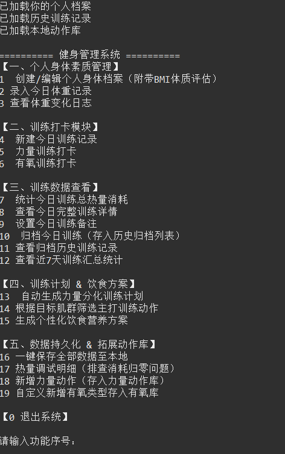
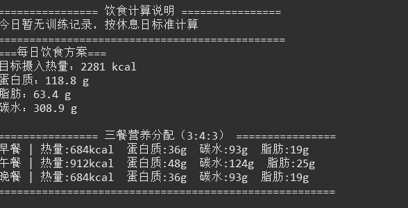

# Fitness Management System (Java)

A command-line personal fitness and nutrition manager built with Java 17. The project explores object-oriented design, local data persistence, and the integration of exercise science and nutrition into software.

## Features

- **User profile:** height, weight, age, sex, and activity level; BMI, BMR, and TDEE calculation; weight tracking.
- **Strength training:** log exercises, sets, weight, and reps.
- **Cardio:** log duration and intensity; estimate calories from MET values.
- **Calorie expenditure:** combine MET and BMR models.
- **Diet plan:** choose a goal (bulk, cut, or maintain); generate daily calories and macronutrient targets with a 3:4:3 meal split.
- **Workout plans:** full-body, two-day split, single-muscle, and push/pull/legs (PPL) plans.
- **History and statistics:** archive daily training, view a 7-day summary, and track weight changes.
- **Muscle recovery reminders:** flag accumulated fatigue in the chest, back, and legs based on training intervals.
- **Persistence:** save the user profile, training history, and exercise library to local files so data survives a restart.

## Tech stack

- **Language:** Java 17+
- **Architecture:** layered object-oriented design (`model` / `util` / `workout`)
- **Persistence:** Java native serialization (`java.io.Serializable`)
- **Interface:** command-line interface (CLI)

## Project structure

```text
src/
├── main/
│   └── Main.java                 # entry point and menu
├── model/
│   ├── Person.java               # profile, BMI/BMR, weight tracking
│   ├── DailyTraining.java        # one day of training
│   ├── WorkoutLog.java           # strength-training log with sets
│   ├── CardioRecord.java         # cardio record
│   ├── Exercise.java             # exercise-library entity
│   ├── MuscleRecoverRule.java    # muscle-recovery rules
│   └── WeightRecord.java         # weight-tracking record
├── util/
│   └── NutritionCalculator.java  # BMR and activity-factor calculations
└── workout/
    └── WorkoutLibrary.java       # exercise library and plan generator
```

## Run

Requirements: JDK 17 or newer.

```bash
# from the repository root
javac -d bin src/main/*.java src/model/*.java src/util/*.java src/workout/*.java
java -cp bin main.Main
```

You can also open the project in IntelliJ IDEA or Eclipse and run `main.Main`.

## Quick start

1. `1` — create a personal profile.
2. `4` — start today's training.
3. `13` — generate a workout plan and import it into today's training.
4. `15` — generate a diet plan.
5. `10` — archive today's training.
6. `11` — view training history.

## Screenshots





## Design notes

- Exercise-science and nutrition rules (MET, BMR, macronutrient split) are implemented as reusable calculations rather than hard-coded menu logic.
- The model, calculation, and workout-library layers are separated so a new interface can reuse the same logic.
- Input validation and null checks are used at the CLI boundary.
- Java serialization keeps the project dependency-free while still providing persistence.

## Future work

- Progressive-overload suggestions based on training history.
- Text-based charts for training trends.
- A GUI or web interface; the React PWA port already covers the web version.

## Related project

The cross-platform React PWA port of this app is available at [fitness-app](https://github.com/Huang-1226/fitness-app).

---

© 2026 Huang1226 · [GitHub](https://github.com/Huang-1226)
